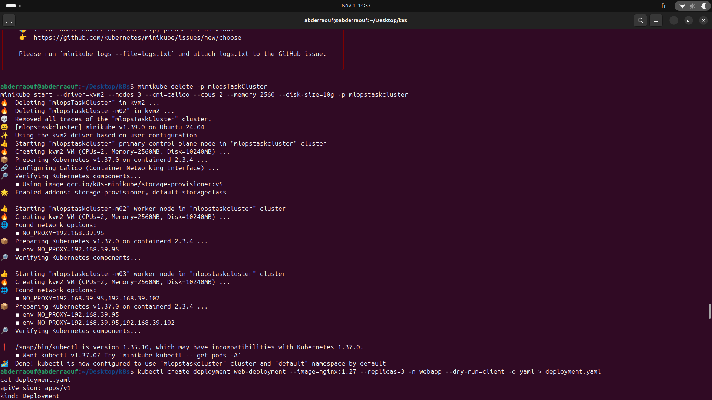
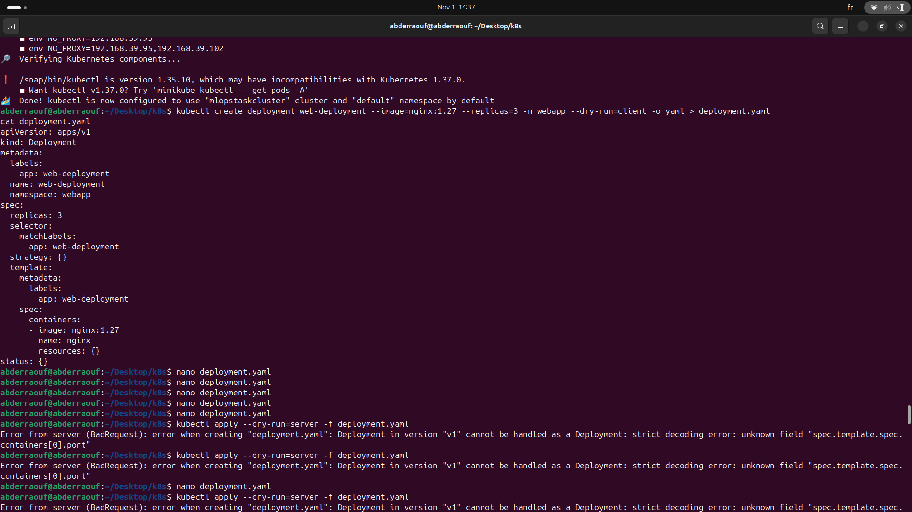
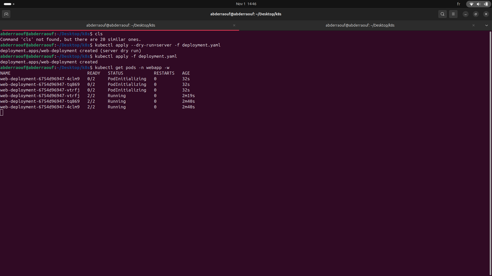
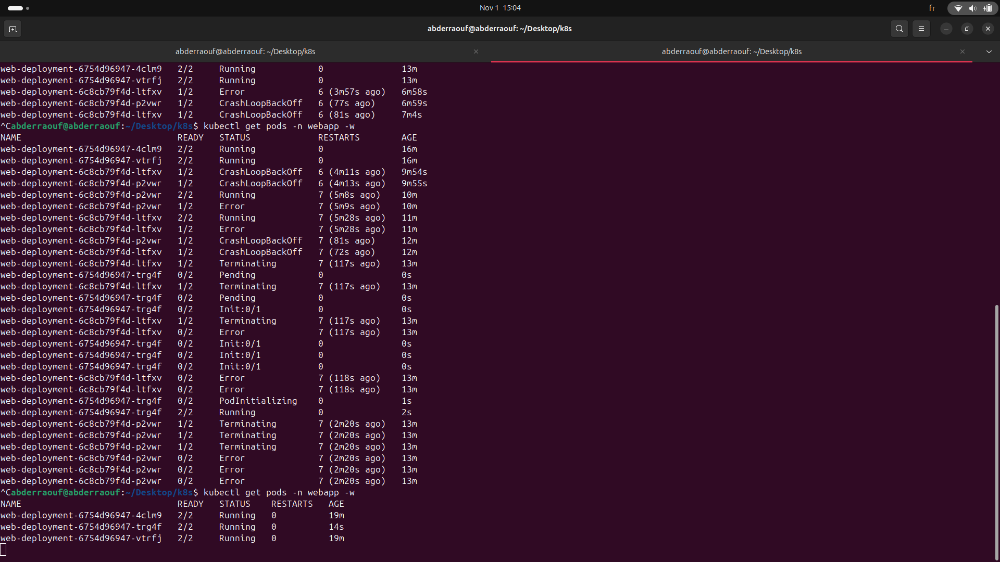
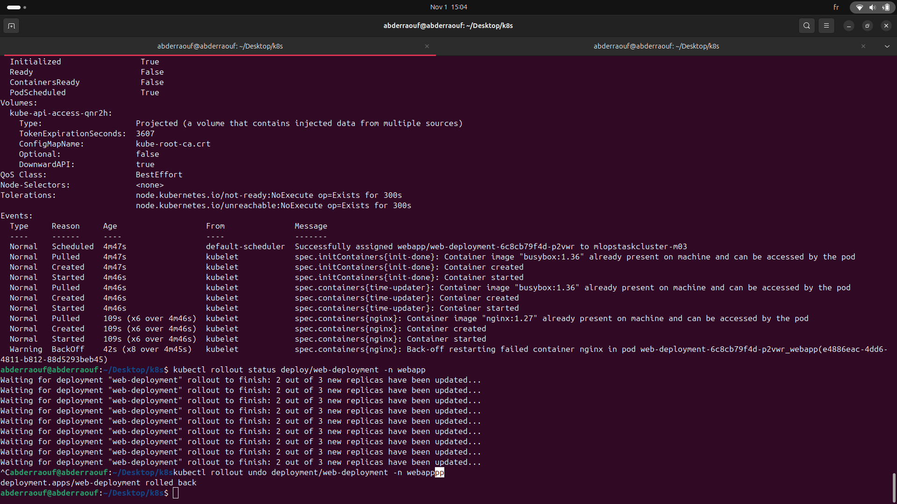
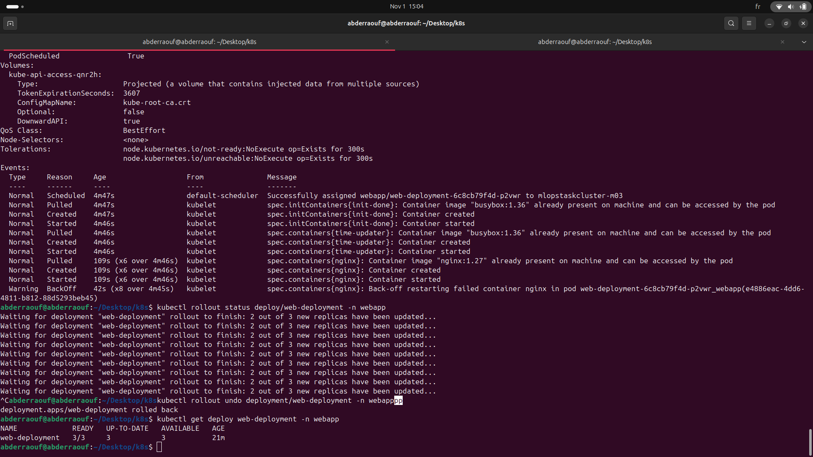

# Kubernetes on KVM with minikube: Multi-node Cluster and Sidecar Deployment

A step-by-step record of building a 3-node Kubernetes cluster on KVM virtual machines, deploying an nginx app with a sidecar and an init container, and handling a failed rollout. Each phase has the commands, the reason, and screenshots as evidence.

**Machine:** Intel i5-8350U (8 threads), 15 GB RAM, Ubuntu 24.04
**Stack:** KVM/libvirt, Virtual Machine Manager, minikube v1.39.0 (kvm2 driver), kubectl 1.35.10, Kubernetes v1.37.0, Calico CNI

## Evidence status (what is and is not backed by a screenshot)

| Phase | Topic | Screenshot |
|---|---|---|
| 1 | Machine check | To add (see TODO) |
| 2 | KVM and tools install | To add (see TODO) |
| 3 | Create the 3-node cluster | Included |
| 4 | Verify nodes and VMs in virt-manager | To add (see TODO) |
| 5 | Write `deployment.yaml` (and the `port` error) | Included |
| 6 | Deploy and watch Pods | Included |
| 7 | Test: page time changes | To add (see TODO) |
| 8 | Failed rollout and rollback | Included (3 screenshots) |

Problems from the first attempts on the earlier 2-node cluster (`mycluster`), such as the kernel panic and the memory fix, are documented from terminal text outputs only. They have no screenshots, because that cluster was deleted.

---

## Phase 1: Check the machine

```bash
egrep -c '(vmx|svm)' /proc/cpuinfo   # must be > 0 (CPU supports virtualization)
df -h /                              # want 15+ GB free
free -h                              # want 8+ GB available
lscpu | grep -E "Model name|CPU\(s\):"
```
**Why:** each VM needs RAM and disk, and KVM needs hardware virtualization.
**Problem found:** only 8 GB of disk was free (97% used). Cleaned with `sudo apt clean && sudo apt autoremove -y`, `sudo journalctl --vacuum-size=200M`, and by deleting old files (17 GB free afterwards). Used `--disk-size 10g` because the default is 20 GB per node.

> TODO screenshot: `df -h /` and `free -h` output. Save as `01-machine-check.png`.

## Phase 2: Install KVM, virt-manager, minikube, kubectl

```bash
sudo apt update
sudo apt install -y cpu-checker qemu-kvm libvirt-daemon-system libvirt-clients bridge-utils virt-manager
kvm-ok
sudo usermod -aG libvirt,kvm $USER      # then log out and back in
sudo systemctl enable --now libvirtd

curl -LO https://storage.googleapis.com/minikube/releases/latest/minikube-linux-amd64
sudo install minikube-linux-amd64 /usr/local/bin/minikube
rm minikube-linux-amd64
sudo snap install kubectl --classic
```
**Why:** libvirt and KVM run the VMs, virt-manager is the GUI, minikube creates the VMs and installs Kubernetes.
**Note:** the `docker` group advice applies only to `--driver=docker`. With `kvm2` the groups that matter are `libvirt` and `kvm`. Run minikube as a normal user, never with `sudo`.

> TODO screenshot: `kvm-ok`, `minikube version`, `groups`. Save as `02-install-check.png`.

## Phase 3: Create the cluster

```bash
minikube delete -p mlopsTaskCluster
minikube start --driver=kvm2 --nodes 3 --cni=calico --cpus 2 --memory 2560 --disk-size=10g -p mlopstaskcluster
```
**Why each flag:**
- `--driver=kvm2`: real VMs, visible in virt-manager.
- `--nodes 3`: one control-plane plus two workers.
- `--cni=calico`: Calico pod networking.
- `--memory 2560`: enough RAM for the VM image to boot (see problems below).
- `--disk-size=10g`: limits each VM disk to protect the host disk.
- `-p mlopstaskcluster`: profile name, **lowercase on purpose**.

**Evidence:** the screenshot shows the old capitalized cluster deleted, then the lowercase one creating the control-plane node, `m02` and `m03` (each CPUs=2, Memory=2560MB, Disk=10240MB), Calico configured, and `Done! kubectl is now configured to use "mlopstaskcluster"`. No join error appeared this time.



### Problems solved in this phase

**A. `domain didn't return IP after 1m30s` (on the first cluster, `mycluster`)**
- Early guesses (a libvirt `wrong nlmsg len` log message, AppArmor denials on `~/.minikube`) were not the cause.
- Looking at the VM console found it:
  ```bash
  virsh -c qemu:///system console mycluster      # exit with Ctrl+]
  ```
  It showed `Kernel panic - not syncing: System is deadlocked on memory`.
- **Root cause:** the minikube v1.39 boot image unpacks its filesystem into RAM, and 2048 MB was not enough. The VM crashed about 5 seconds after boot, so it never requested an IP.
- **Fix:** `--memory 3072` worked, and later `2560` worked too.
- **Lesson:** check the VM console before changing host settings.

**B. `nodes "...-m02" not found` while joining the worker**
- With the lowercase profile `mycluster`, this was a timing issue and running `minikube start -p mycluster` again finished the job.
- With the capitalized profile `mlopsTaskCluster`, it kept failing, because Kubernetes node names must be lowercase while minikube looked for the capitalized name.
- **Fix confirmed by the screenshot above:** recreating the cluster as `mlopstaskcluster` created all three nodes without that error.

**C. A purge that undid a fix**
`minikube delete --purge` removed `~/.minikube`, including permissions set earlier, and forced a 750 MB re-download. Use plain `minikube delete -p <profile>`.

## Phase 4: Verify the nodes

```bash
kubectl get nodes -o wide
```
Expected: `mlopstaskcluster` (control-plane), `mlopstaskcluster-m02` and `mlopstaskcluster-m03`, all `Ready`. Then open **virt-manager** to see the three VMs running.

> TODO screenshots: `kubectl get nodes -o wide` as `04a-get-nodes.png`, and virt-manager showing the VMs as `04b-virt-manager.png`.

Harmless warnings seen: the Docker context warning (Docker is installed but not used by kvm2), and kubectl 1.35 versus cluster 1.37 (within the supported version difference).

## Phase 5: Write the Deployment

```bash
kubectl create namespace webapp
kubectl create deployment web-deployment --image=nginx:1.27 --replicas=3 -n webapp --dry-run=client -o yaml > deployment.yaml
```
`--dry-run=client` generates the file without creating anything. The skeleton uses the label `app: web-deployment`, which must be changed to `app: web` in the metadata, `selector.matchLabels` and the Pod template labels.

**Evidence:** the screenshot shows the generated skeleton, several `nano` edits, and then `kubectl apply --dry-run=server` rejecting the file:

```
unknown field "spec.template.spec.containers[0].port"
```



**Root cause:** the field is `ports:` (plural), not `port:`. The server-side dry run caught it before anything was deployed, which is why it is worth running before `apply`.

Another bug that does not produce an error: without `shareProcessNamespace: true`, the sidecar cannot see nginx, `pgrep` returns nothing, and the page never updates even though the Pods look healthy.

### Final `deployment.yaml`
```yaml
apiVersion: apps/v1
kind: Deployment
metadata:
  labels:
    app: web
  name: web-deployment
  namespace: webapp
spec:
  replicas: 3
  selector:
    matchLabels:
      app: web
  template:
    metadata:
      labels:
        app: web
    spec:
      shareProcessNamespace: true
      initContainers:
        - name: init-done
          image: busybox:1.36
          command: ["sh", "-c", "echo done"]
      containers:
        - name: nginx
          image: nginx:1.27
          ports:
            - containerPort: 80
          command: ["/bin/sh", "-c"]
          args:
            - |
              echo "<h1>hello in MLOPS MENA COMMUNITY : $(date '+%Y-%m-%d %H:%M:%S')</h1>" > /usr/share/nginx/html/index.html
              nginx -g 'daemon off;'
        - name: time-updater
          image: busybox:1.36
          securityContext:
            capabilities:
              add: ["SYS_PTRACE"]
          command: ["sh", "-c"]
          args:
            - |
              while true; do
                PID=$(pgrep -o nginx)
                if [ -n "$PID" ]; then
                  echo "<h1>hello in MLOPS MENA COMMUNITY : $(date '+%Y-%m-%d %H:%M:%S')</h1>" \
                    > /proc/$PID/root/usr/share/nginx/html/index.html
                fi
                sleep 5
              done
```

| Piece | Purpose |
|---|---|
| `shareProcessNamespace: true` | Containers in the Pod see each other's processes (Pod-level setting) |
| Init container `init-done` | Runs once and must succeed before the main containers start |
| nginx `command` + `args` | Writes the first page, then runs nginx in the foreground (`daemon off;`) so the container stays alive |
| `pgrep -o nginx` | Finds the oldest nginx process, the master |
| `/proc/$PID/root/...` | nginx's filesystem seen from the sidecar, so no volume is needed |
| `SYS_PTRACE` | Permission needed to write through `/proc/<pid>/root` |
| No `volumes` | The task forbids them |

## Phase 6: Deploy and watch

```bash
kubectl apply --dry-run=server -f deployment.yaml     # validate against the real API
kubectl apply -f deployment.yaml
kubectl get pods -n webapp -w                          # Ctrl+C to stop
```
**Evidence:** the screenshot shows the server dry run succeeding (`created (server dry run)`), then `deployment.apps/web-deployment created`, and the three Pods going from `0/2 PodInitializing` to `2/2 Running`. They show `2/2` because the two regular containers count and the finished init container does not.



(The `cls` line in the screenshot is a typo for `clear`. It is harmless.)

Extra checks to run and screenshot if the reviewer asks:
```bash
kubectl get pods -n webapp -o wide                                          # which node each Pod runs on
kubectl logs deploy/web-deployment -n webapp -c init-done                   # prints: done
kubectl get deploy web-deployment -n webapp -o jsonpath='{.spec.template.spec.volumes}'   # empty = no volumes
```

## Phase 7: Test that the time updates

```bash
kubectl port-forward -n webapp deploy/web-deployment 8080:80     # keep running
curl -s localhost:8080; sleep 6; curl -s localhost:8080          # second terminal
```
Or use `kubectl exec deploy/web-deployment -n webapp -c nginx -- cat /usr/share/nginx/html/index.html` twice, a few seconds apart. During the session this showed `13:48:18` and then `13:48:23`, proving the sidecar rewrites nginx's file.

> TODO screenshots: the browser at http://localhost:8080 before and after a refresh, or the two `curl` outputs. Save as `07a-page-before.png` and `07b-page-after.png`.

## Phase 8: A failed rollout and the rollback

While testing an init-container failure, the file was edited and re-applied. The new Pods (ReplicaSet `6c8cb79f4d`) never became healthy.

**What the screenshots show**

1. Watching Pods (second terminal): the new Pods show `1/2 CrashLoopBackOff` and `Error` with rising restart counts, while the old Pods (`6754d96947`) stay `2/2 Running`. After the rollback the bad Pods go `Terminating` and a new `6754d96947` Pod goes `Pending`, `Init:0/1`, `PodInitializing`, `Running`.

   

2. `kubectl describe pod` on a bad Pod: `Initialized True`, `Ready False`, `ContainersReady False`. The events show the init container and `time-updater` started normally, and the warning is **`Back-off restarting failed container nginx`**. `kubectl rollout status` repeats `2 out of 3 new replicas have been updated`, so the rollout is stuck. Then `kubectl rollout undo` prints `rolled back`.

   

3. After the undo: `kubectl get deploy web-deployment -n webapp` shows `READY 3/3`, `UP-TO-DATE 3`, `AVAILABLE 3`.

   

**How to read it**
- A failing init container would show `Init:Error` with `0/2`. The Pods here were `1/2`, and the events point at the **nginx** container, so the init container was not the failing part.
- A rolling update replaces old Pods only as new ones become available, so the old Pods kept serving while the new ones crashed. This is the safety behaviour working.
- **The exact reason nginx crashed was not captured.** The edited file was not saved with the failing version, and the logs were not collected. To diagnose a crash like this, run:
  ```bash
  kubectl logs <pod> -n webapp -c nginx --previous
  kubectl describe pod <pod> -n webapp
  ```

**Commands used**
```bash
kubectl rollout status deploy/web-deployment -n webapp
kubectl rollout undo deployment/web-deployment -n webapp
kubectl rollout history deployment/web-deployment -n webapp
```
`rollout undo` changes the cluster, not the local file, so keep a known-good copy: `cp deployment.yaml deployment-good.yaml`. Always include `-n webapp` or kubectl reports "not found".

---

## Everyday operations

```bash
kubectl rollout restart deployment/web-deployment -n webapp      # replace Pods gradually
kubectl scale deployment/web-deployment -n webapp --replicas=0   # all down
kubectl scale deployment/web-deployment -n webapp --replicas=3   # all back up
minikube stop -p mlopstaskcluster                                # pause the cluster
minikube delete -p mlopstaskcluster                              # remove it
```

## Troubleshooting cheat sheet

| Symptom | First thing to check |
|---|---|
| `didn't return IP` | `virsh -c qemu:///system console <vm>`: look for a kernel panic, raise `--memory` |
| `nodes "...-m02" not found` | Capitals in the profile name? Otherwise run `minikube start -p <profile>` again |
| `unknown field` on apply | Field name typo (`port` vs `ports`); use `--dry-run=server` first |
| `CrashLoopBackOff` | `kubectl logs <pod> -c <container> --previous` and `kubectl describe pod` |
| `Init:Error` / `0/2` | The init container failed: `kubectl logs <pod> -c init-done` |
| Page never updates | `shareProcessNamespace: true` or `SYS_PTRACE` missing |
| kubectl says "not found" | Missing `-n webapp`, or wrong cluster (`kubectl config current-context`) |

## Lessons learned

1. Look at the VM console before changing host settings.
2. Use lowercase profile names in minikube.
3. Validate with `kubectl apply --dry-run=server` before applying.
4. Keep a known-good copy of every YAML before experimenting.
5. Capture logs (`--previous`) at the moment something crashes.
6. Watch memory (about 2.5 to 3 GB per node) and disk space on a laptop.

## Repository layout

```
Kubernetes-Course-Tasks/
├── README.md
├── deployment.yaml
└── images/
    ├── 03-cluster-start-lowercase-3-nodes.png
    ├── 05-deployment-skeleton-and-port-error.png
    ├── 06-apply-and-pods-running.png
    ├── 08a-watch-crashloop-and-recovery.png
    ├── 08b-describe-events-and-rollout-undo.png
    └── 08c-rollback-result-3-of-3.png
```
